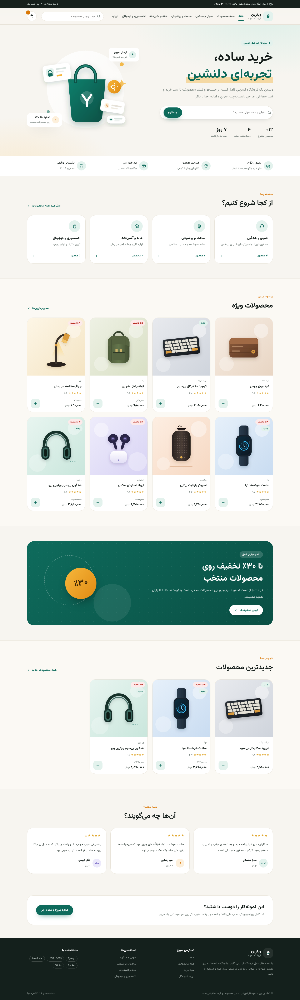
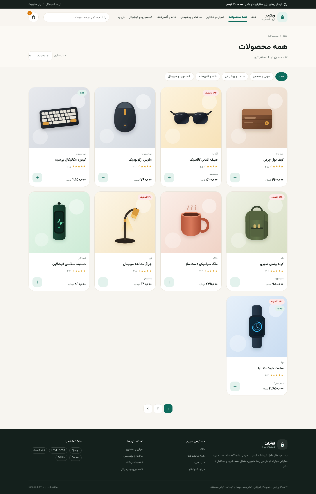
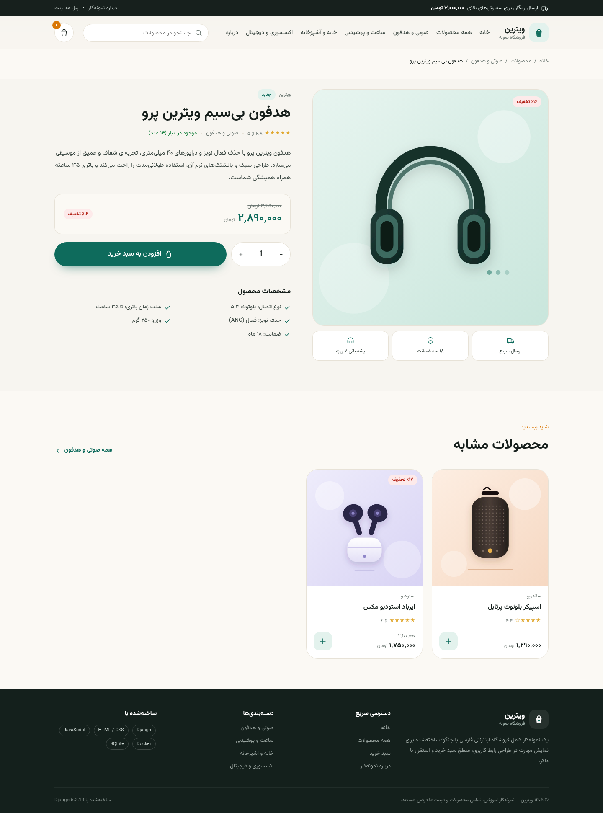
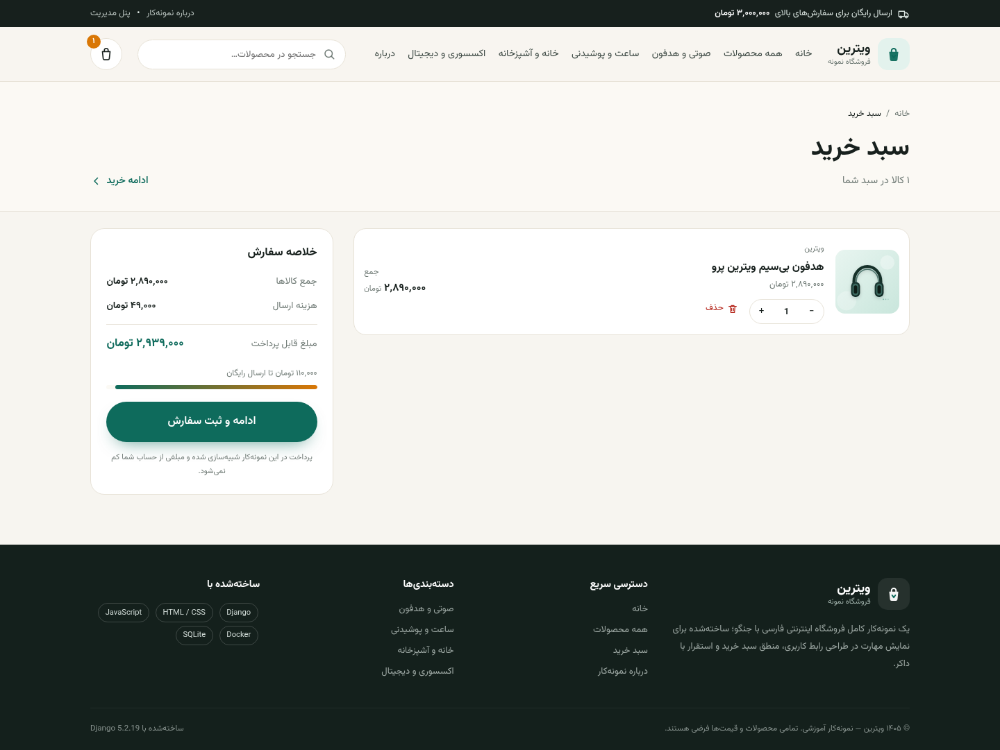
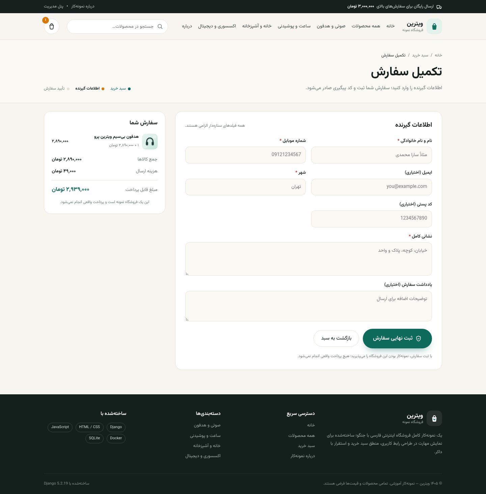
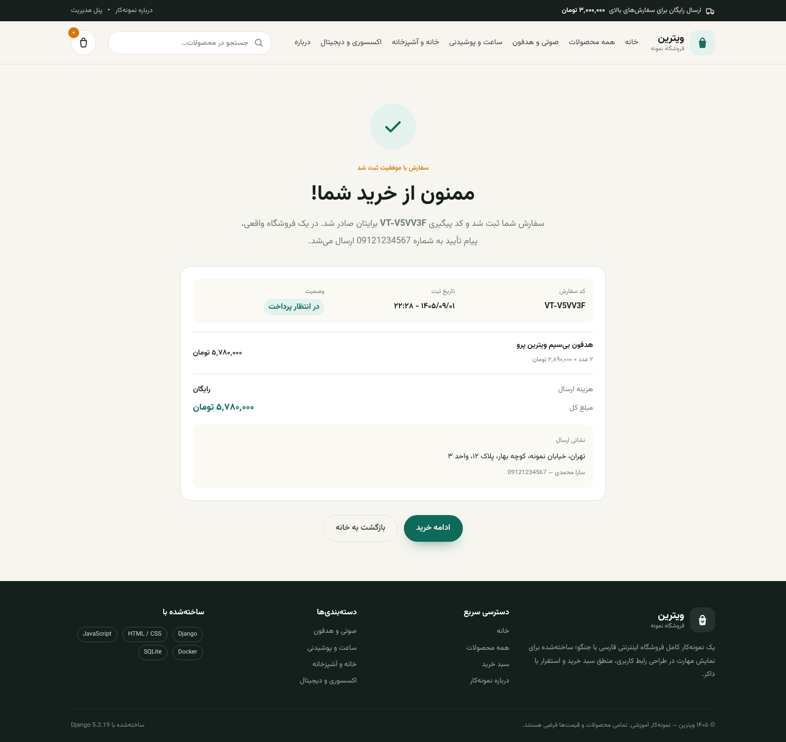
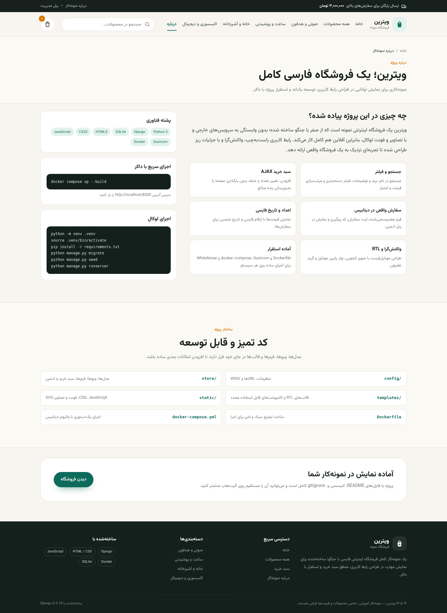
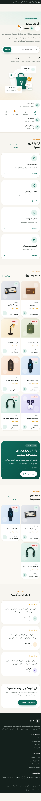

<div align="center" dir="rtl">

# 🛍️ ویترین — فروشگاه اینترنتی نمونه

**یک فروشگاه آنلاین کامل و راست‌به‌چپ با جنگو و HTML / CSS / JavaScript خالص.**

[](https://www.python.org/)
[](https://www.djangoproject.com/)
[](https://www.docker.com/)
[](#-تست‌ها)
[](LICENSE)

[فارسی](README.fa.md) · [English](README.md)

</div>

---

<div dir="rtl">

## 📖 دربارهٔ پروژه

**ویترین** یک فروشگاه اینترنتی نمونه‌کار (Portfolio) برای بازار فارسی است. رابط کاربری
کاملاً راست‌به‌چپ است، از اعداد فارسی و تقویم جلالی استفاده می‌کند و شامل کاتالوگ واقعی،
سبد خرید مبتنی بر session، فرایند تسویه‌حساب با ثبت سفارش در دیتابیس و پنل مدیریت فارسی است.

فرانت‌اند با **HTML، CSS و JavaScript خالص** نوشته شده — بدون React، بدون مرحلهٔ build و
بدون bundler. پروژه در سه حالت اجرا می‌شود:

- 🐳 **داکر** — با یک دستور، بدون نیاز به پایتون نصب‌شده روی سیستم
- 💻 **لوکال** — با `venv` و `manage.py runserver`
- ☁️ **هر هاستی** — فایل‌های استاتیک با WhiteNoise و اپ با gunicorn سرو می‌شود

> اطلاعات ورود ادمین نمونه (به‌صورت خودکار توسط Docker Compose ساخته می‌شود):
> **نام کاربری** `admin` · **رمز عبور** `admin1234` → مسیر `/admin/`

---

## ✨ امکانات

| بخش | توضیح |
|---|---|
| **صفحهٔ اصلی** | بنر هیرو، محصولات ویژه، شبکهٔ دسته‌بندی‌ها، نوار تبلیغاتی |
| **لیست محصولات** | جست‌وجوی متنی، فیلتر دسته‌بندی، مرتب‌سازی (جدیدترین / ارزان‌ترین / گران‌ترین)، صفحه‌بندی |
| **صفحهٔ محصول** | تصویر، قیمت و تخفیف، وضعیت موجودی، جدول مشخصات، انتخاب تعداد، محصولات مشابه |
| **سبد خرید** | مبتنی بر session (بدون نیاز به لاگین)، افزودن / تغییر / حذف با AJAX، نشانگر زندهٔ تعداد در هدر |
| **تسویه‌حساب** | فرم فارسی با اعتبارسنجی (موبایل و کد پستی)، منطق هزینهٔ ارسال، خلاصهٔ خرید |
| **سفارش‌ها** | ذخیره در دیتابیس با کد خوانا (`VT-XXXXXX`) و صفحهٔ موفقیت |
| **پنل مدیریت** | ادمین فارسی جنگو با آیتم‌های سفارش به‌صورت inline، مدیریت کاتالوگ، جست‌وجو و فیلتر |
| **تجربهٔ فارسی** | چیدمان RTL، فونت وزیرمتن، اعداد فارسی، جداکنندهٔ `٬`، تاریخ جلالی |
| **ارسال رایگان** | ارسال رایگان خودکار بالای مبلغ قابل‌تنظیم، همراه نوار پیشرفت |
| **ریسپانسیو** | طراحی موبایل‌محور، منوی کشویی، کنترل‌های مناسب لمس |
| **عملیات** | endpoint سلامت، healthcheck داکر، WhiteNoise، gunicorn، وورک‌فلوی CI |

---

## 📸 تصاویر

| صفحهٔ اصلی | لیست محصولات |
|---|---|
|  |  |

| صفحهٔ محصول | سبد خرید |
|---|---|
|  |  |

| تسویه‌حساب | تأیید سفارش |
|---|---|
|  |  |

| دربارهٔ ما | موبایل |
|---|---|
|  |  |

---

## 🚀 شروع سریع

### روش اول — داکر (پیشنهادی)

```bash
git clone https://github.com/<your-username>/vitrin-shop.git
cd vitrin-shop
docker compose up --build
```

سپس **http://localhost:8000** را باز کنید — کاتالوگ و ادمین نمونه به‌صورت خودکار ساخته می‌شوند.

### روش دوم — اجرای لوکال

```bash
python -m venv .venv
source .venv/bin/activate          # ویندوز: .venv\Scripts\activate
pip install -r requirements.txt

python manage.py migrate
python manage.py seed              # ۴ دسته‌بندی + ۱۲ محصول نمونه
python manage.py createsuperuser   # اختیاری، برای /admin/
python manage.py runserver
```

سپس **http://127.0.0.1:8000** را باز کنید.

> در ویندوز از `py -m venv .venv` و `.venv\Scripts\activate` استفاده کنید.

---

## 🧱 پشتهٔ فناوری

| لایه | انتخاب |
|---|---|
| بک‌اند | جنگو ۵.۲ (پایتون ۳.۱۲) |
| دیتابیس | SQLite (بدون تنظیمات؛ قابل تغییر با `SQLITE_PATH`) |
| فرانت‌اند | HTML5، CSS مدرن (متغیرها، grid، flex)، JavaScript خالص (ES2020) |
| فونت | وزیرمتن (فایل `woff2` میزبانی‌شده در پروژه) |
| سرور WSGI | gunicorn |
| فایل‌های استاتیک | WhiteNoise + ذخیره‌سازی فشرده |
| کانتینر | `python:3.12-slim`، کاربر غیر-root |
| CI | GitHub Actions — اجرای `manage.py check` و تست‌ها |

---

## 🗂 ساختار پروژه

```
vitrin-shop/
├── config/                     # تنظیمات پروژهٔ جنگو (settings, urls, wsgi, asgi)
├── store/
│   ├── models.py               # Category, Product, Order, OrderItem
│   ├── views.py                # ویوهای فروشگاه، سبد خرید، تسویه، سلامت
│   ├── cart.py                 # سبد خرید session با محاسبهٔ جمع و ارسال
│   ├── forms.py                # فرم فارسی تسویه + اعتبارسنجی
│   ├── admin.py                # ادمین فارسی با آیتم‌های inline سفارش
│   ├── context_processors.py   # نشانگر سبد، دسته‌بندی‌های منو، تنظیمات فروشگاه
│   ├── utils.py                # قالب‌بندی مبلغ فارسی، تبدیل جلالی
│   ├── templatetags/persian.py # فیلترهای fa / money / jalali / stars
│   ├── management/commands/seed.py
│   └── tests.py                # ۱۱ تست
├── templates/                  # قالب‌های پایه و فروشگاه (RTL)
├── static/
│   ├── css/style.css           # سیستم طراحی (~۲۰۰۰ خط)
│   ├── js/main.js              # سبد AJAX، منو، توست، اعتبارسنجی
│   ├── fonts/                  # وزیرمتن woff2
│   └── img/                    # هیرو، فاوآیکون، تصاویر SVG محصولات
├── screenshots/                # تصاویر README
├── Dockerfile
├── docker-compose.yml
├── entrypoint.sh               # migrate → seed → collectstatic → gunicorn
├── .env.example
└── .github/workflows/ci.yml
```

---

## ⚙️ تنظیمات

همهٔ تنظیمات از طریق متغیرهای محیطی کنترل می‌شوند — برای استقرار نیازی به تغییر کد نیست.

| متغیر | پیش‌فرض | توضیح |
|---|---|---|
| `DEBUG` | `1` لوکال / `0` داکر | حالت دیباگ. در پروداکشن `0` بماند. |
| `SECRET_KEY` | کلید ناامن توسعه | **در پروداکشن حتماً کلید واقعی بگذارید.** |
| `ALLOWED_HOSTS` | `*` (دیباگ) | نام هاست‌ها با کاما جدا شوند. |
| `CSRF_TRUSTED_ORIGINS` | خالی | مثلاً `https://shop.example.com` (پشت پروکسی HTTPS لازم است). |
| `SQLITE_PATH` | `db.sqlite3` | مسیر فایل دیتابیس. در داکر `/app/data/db.sqlite3`. |
| `SHIPPING_PRICE` | `49000` | هزینهٔ ثابت ارسال به تومان. |
| `FREE_SHIPPING_THRESHOLD` | `3000000` | مبلغی که بالای آن ارسال رایگان می‌شود. |
| `SEED_DEMO_DATA` | `1` | ساخت کاتالوگ و ادمین نمونه هنگام بالا آمدن کانتینر. |
| `DEMO_ADMIN_USERNAME` | `admin` | نام کاربری ادمین نمونه. |
| `DEMO_ADMIN_PASSWORD` | `admin1234` | رمز ادمین نمونه (**تغییر دهید**). |
| `PORT` | `8000` | پورت gunicorn. |
| `WEB_CONCURRENCY` | `3` | تعداد worker های gunicorn. |

برای اجرای لوکال، `.env.example` را به `.env` کپی کنید.

---

## 🐳 چرخهٔ عمر داکر

| هدف | دستور |
|---|---|
| اجرا (در صورت نیاز build) | `docker compose up --build` |
| اجرا در پس‌زمینه | `docker compose up -d` |
| توقف (کانتینر باقی می‌ماند) | `docker compose stop` |
| اجرای مجدد | `docker compose start` |
| حذف کانتینر و شبکه (**ایمیج و دیتا می‌مانند**) | `docker compose down` |
| حذف کانتینر **و ایمیج** | `docker compose down --rmi all` |
| حذف همه‌چیز **به‌همراه volume دیتابیس** | `docker compose down -v` |
| دیدن لاگ‌ها | `docker compose logs -f` |
| ورود به شل کانتینر | `docker compose exec web sh` |
| ساخت مجدد کاتالوگ | `docker compose exec web python manage.py seed` |

**چه چیزی بعد از چه دستوری می‌ماند؟**

- `stop` یا `down` → ایمیج `vitrin-shop:latest` **روی دیسک می‌ماند** و اجرای بعدی فوری است.
- `down` → کانتینر حذف می‌شود؛ اما دیتابیس SQLite داخل volume نام‌دار `vitrin_data` است و **باقی می‌ماند**.
- فقط `docker image rm vitrin-shop` (یا `down --rmi all`) ایمیج را پاک می‌کند.
- فقط `down -v` حجم را پاک می‌کند — یعنی **سفارش‌ها و کاتالوگ از بین می‌روند**.

---

## 🧪 تست‌ها

```bash
python manage.py test
```

پوشش تست‌ها شامل صفحهٔ اصلی، جست‌وجو و فیلتر، صفحهٔ محصول، endpoint های AJAX سبد خرید،
اعتبارسنجی تسویه (از جمله شمارهٔ موبایل نامعتبر)، ثبت سفارش، توابع مبلغ فارسی و جلالی،
و idempotent بودن seed است.

CI نیز در هر push همین تست‌ها را از طریق `.github/workflows/ci.yml` اجرا می‌کند.

---

## 📤 انتشار روی گیت‌هاب

```bash
git init
git add .
git commit -m "Initial commit: Vitrin Persian e-commerce demo"
git branch -M main
git remote add origin https://github.com/<your-username>/vitrin-shop.git
git push -u origin main
```

یا با GitHub CLI:

```bash
gh repo create vitrin-shop --public --source=. --remote=origin --push
```

فایل `.gitignore` موجود، `db.sqlite3`، `.env*`، `.venv/`، `staticfiles/` و `data/` را از
مخزن بیرون نگه می‌دارد، بنابراین هیچ رمز یا وضعیت محلی منتشر نمی‌شود.

---

## 🔐 نکات پروداکشن

- `DEBUG=0`، یک `SECRET_KEY` قوی و `ALLOWED_HOSTS` مشخص تنظیم کنید.
- اپ را پشت یک پروکسی معکوس با TLS (nginx / Caddy) قرار دهید و origin آن را به
  `CSRF_TRUSTED_ORIGINS` اضافه کنید.
- رمز ادمین نمونه را تغییر دهید، یا `SEED_DEMO_DATA=0` بگذارید و superuser خودتان را بسازید.
- SQLite برای دمو و فروشگاه کوچک عالی است؛ برای ترافیک واقعی به PostgreSQL مهاجرت کنید.
- فایل‌های استاتیک با WhiteNoise سرو می‌شوند — نیازی به CDN یا تنظیم جداگانهٔ nginx نیست.

---

## 📄 مجوز

تحت [مجوز MIT](LICENSE) منتشر شده است.

<div align="center">

ساخته‌شده با ☕ و جنگو · [English](README.md)

</div>

</div>
