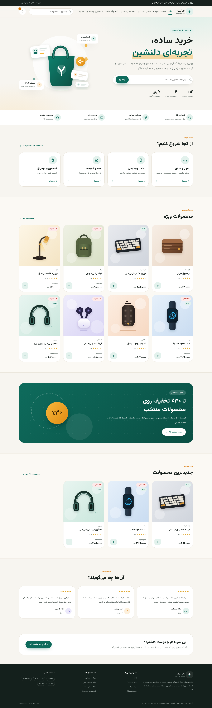
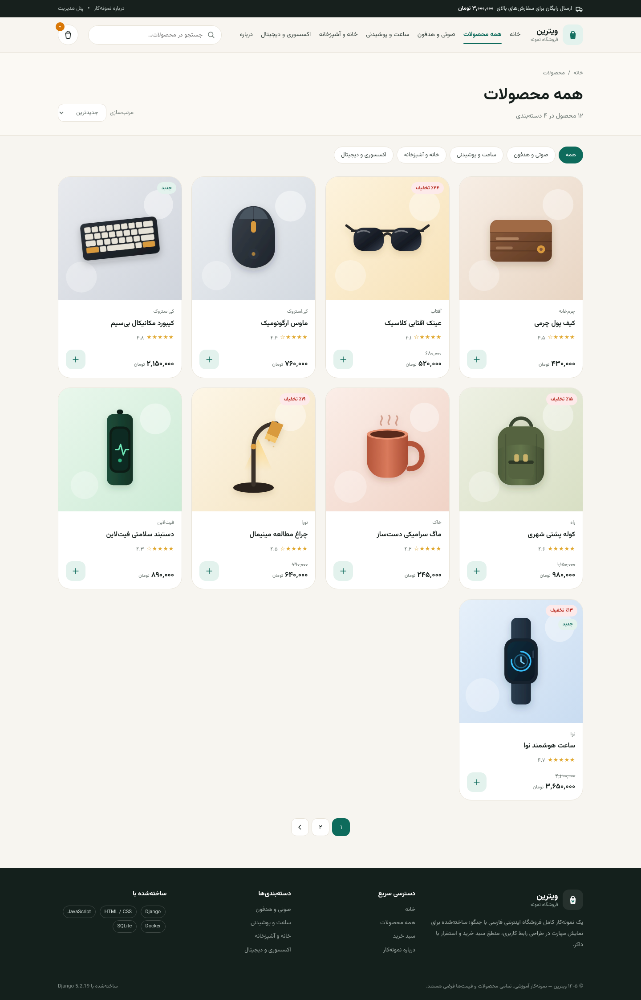
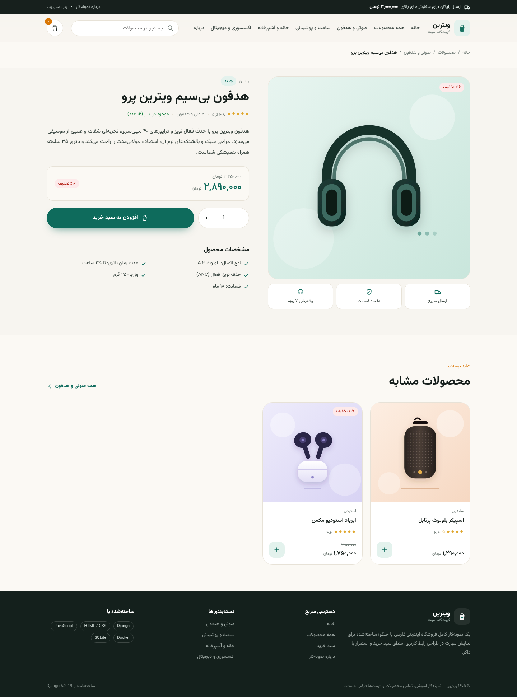
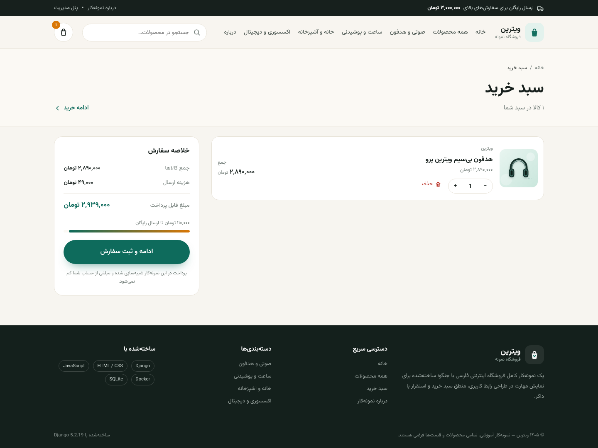
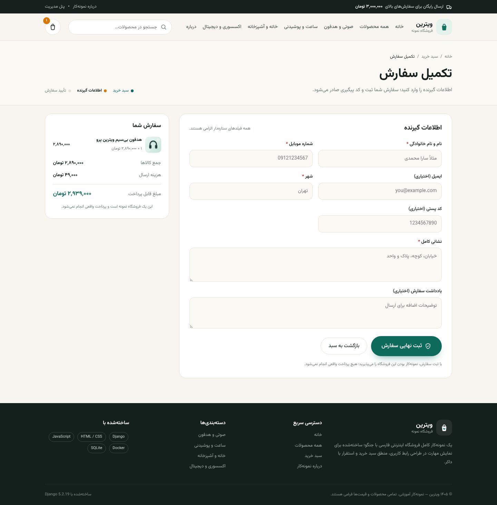
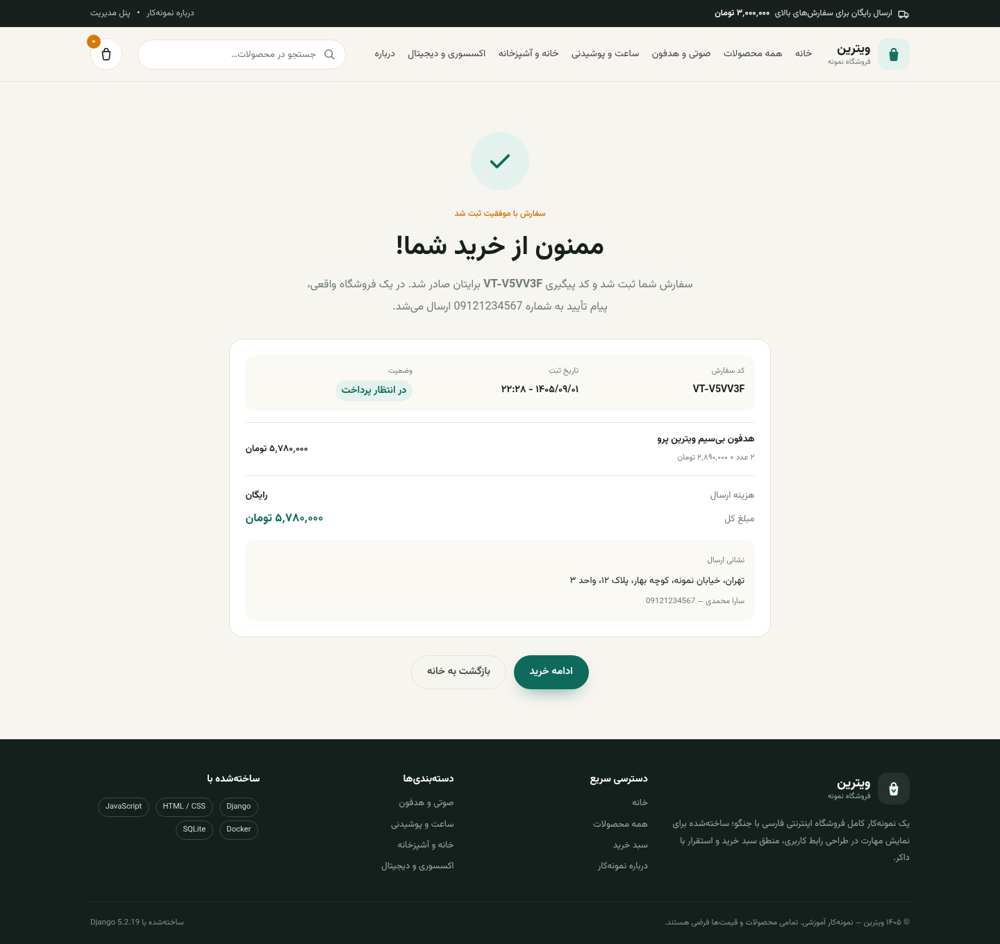
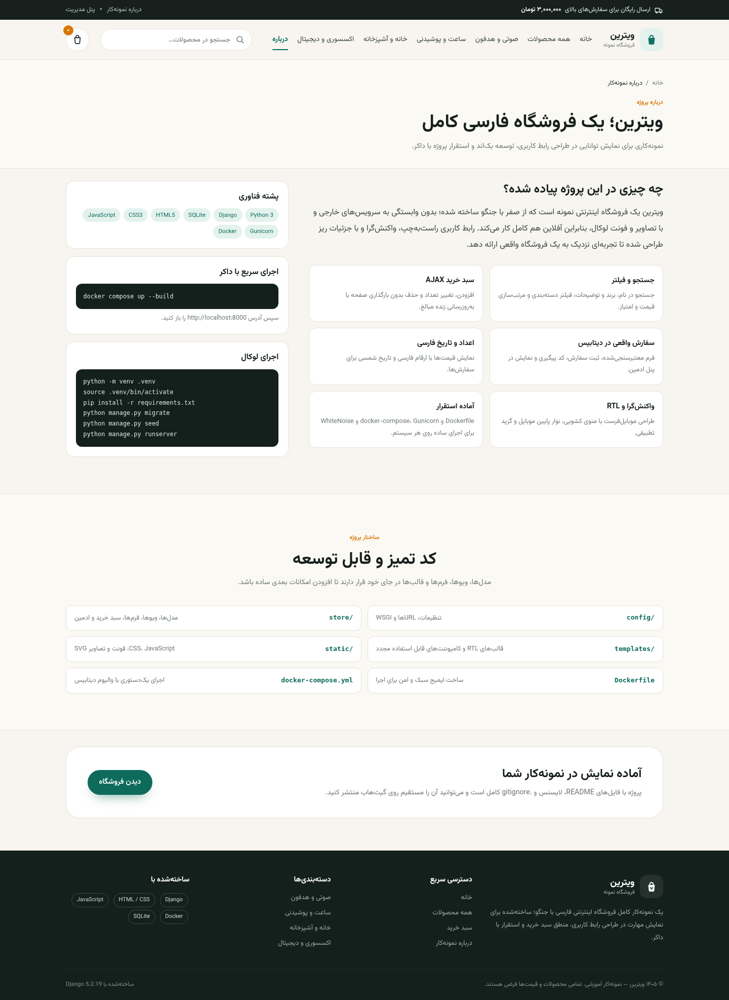
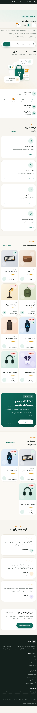

<div align="center">

# 🛍️ Vitrin — Persian E-commerce Demo

**A complete, RTL-first online store built with Django and vanilla HTML / CSS / JavaScript.**

[](https://www.python.org/)
[](https://www.djangoproject.com/)
[](https://www.docker.com/)
[](#-tests)
[](LICENSE)

[فارسی](README.fa.md) · [English](README.md)

</div>

---

## 📖 Overview

**Vitrin** is a portfolio-grade e-commerce storefront for the Persian market. It is fully
right-to-left, uses Persian digits and the Jalali calendar, and ships with a real catalog,
a session-based cart, a checkout flow that persists orders, and a localized Django admin.

The front end is **plain HTML, CSS and JavaScript** — no React, no build step, no bundler.
The whole project runs three ways:

- 🐳 **Docker** — one command, no local Python required
- 💻 **Local** — `venv` + `manage.py runserver`
- ☁️ **Any host** — WhiteNoise serves static files, gunicorn serves the app

> Demo admin credentials (created automatically by Docker Compose):
> **username** `admin` · **password** `admin1234` → `/admin/`

---

## ✨ Features

| Area | What it does |
|---|---|
| **Home page** | Hero banner, featured products, category grid, promo strip |
| **Product listing** | Full-text search, category filter, sorting (newest / cheapest / priciest), pagination |
| **Product page** | Image, price & discount, stock state, specs table, quantity picker, related products |
| **Cart** | Session-based (no login needed), add / update / remove via AJAX, live badge in the header |
| **Checkout** | Validated Persian form (mobile & postal code), shipping logic, order summary |
| **Orders** | Persisted in the database with a human-readable code (`VT-XXXXXX`) and a success page |
| **Admin** | Localized Django admin with inline order items, catalog management, search & filters |
| **Persian UX** | RTL layout, Vazirmatn font, Persian digits, `٬` thousands separator, Jalali dates |
| **Free shipping** | Automatic free shipping above a configurable cart total, with a progress bar |
| **Responsive** | Mobile-first layout, off-canvas menu, touch-friendly controls |
| **Ops** | Health endpoint, Docker healthcheck, WhiteNoise, gunicorn, CI workflow |

---

## 📸 Screenshots

| Home | Product listing |
|---|---|
|  |  |

| Product detail | Cart |
|---|---|
|  |  |

| Checkout | Order confirmation |
|---|---|
|  |  |

| About | Mobile |
|---|---|
|  |  |

---

## 🚀 Quick Start

### Option 1 — Docker (recommended)

```bash
git clone https://github.com/<your-username>/vitrin-shop.git
cd vitrin-shop
docker compose up --build
```

Open **http://localhost:8000** — the catalog and the demo admin are seeded automatically.

### Option 2 — Local development

```bash
python -m venv .venv
source .venv/bin/activate          # Windows: .venv\Scripts\activate
pip install -r requirements.txt

python manage.py migrate
python manage.py seed              # 4 categories + 12 demo products
python manage.py createsuperuser   # optional, for /admin/
python manage.py runserver
```

Open **http://127.0.0.1:8000**.

> On Windows use `py -m venv .venv` and `.venv\Scripts\activate`.

---

## 🧱 Tech Stack

| Layer | Choice |
|---|---|
| Backend | Django 5.2 (Python 3.12) |
| Database | SQLite (zero-config; swap via `SQLITE_PATH` or a custom `DATABASES`) |
| Front end | HTML5, modern CSS (custom properties, grid, flex), vanilla JS (ES2020) |
| Font | Vazirmatn (self-hosted `woff2`) |
| WSGI server | gunicorn |
| Static files | WhiteNoise + compressed manifest storage |
| Container | `python:3.12-slim`, non-root user, multi-stage-free slim image |
| CI | GitHub Actions — `manage.py check` + test suite |

---

## 🗂 Project Structure

```
vitrin-shop/
├── config/                     # Django project (settings, urls, wsgi, asgi)
├── store/
│   ├── models.py               # Category, Product, Order, OrderItem
│   ├── views.py                # Storefront, cart, checkout, health
│   ├── cart.py                 # Session cart with totals & shipping logic
│   ├── forms.py                # Persian checkout form + validation
│   ├── admin.py                # Localized admin with inline order items
│   ├── context_processors.py   # Cart badge, nav categories, shop settings
│   ├── utils.py                # Persian money formatting, Jalali conversion
│   ├── templatetags/persian.py # fa / money / jalali / stars filters
│   ├── management/commands/seed.py
│   └── tests.py                # 11 tests
├── templates/                  # base + storefront templates (RTL)
├── static/
│   ├── css/style.css           # Design system (~2k lines)
│   ├── js/main.js              # AJAX cart, menu, toasts, validation
│   ├── fonts/                  # Vazirmatn woff2
│   └── img/                    # Hero, favicon, product illustrations (SVG)
├── screenshots/                # README images
├── Dockerfile
├── docker-compose.yml
├── entrypoint.sh               # migrate → seed → collectstatic → gunicorn
├── .env.example
└── .github/workflows/ci.yml
```

---

## ⚙️ Configuration

All settings are environment-driven — no code changes needed to deploy.

| Variable | Default | Description |
|---|---|---|
| `DEBUG` | `1` local / `0` Docker | Debug mode. Keep `0` in production. |
| `SECRET_KEY` | insecure dev key | **Set a real secret in production.** |
| `ALLOWED_HOSTS` | `*` (debug) | Comma-separated hostnames. |
| `CSRF_TRUSTED_ORIGINS` | empty | e.g. `https://shop.example.com` (required behind HTTPS proxy). |
| `SQLITE_PATH` | `db.sqlite3` | Database file path. Docker uses `/app/data/db.sqlite3`. |
| `SHIPPING_PRICE` | `49000` | Flat shipping cost in Toman. |
| `FREE_SHIPPING_THRESHOLD` | `3000000` | Cart total above which shipping is free. |
| `SEED_DEMO_DATA` | `1` | Seed catalog + demo admin on container start. |
| `DEMO_ADMIN_USERNAME` | `admin` | Demo admin username. |
| `DEMO_ADMIN_PASSWORD` | `admin1234` | Demo admin password (**change it**). |
| `PORT` | `8000` | gunicorn bind port. |
| `WEB_CONCURRENCY` | `3` | gunicorn worker count. |

Copy `.env.example` to `.env` to customize local runs.

---

## 🐳 Docker Lifecycle

| Goal | Command |
|---|---|
| Start (build if needed) | `docker compose up --build` |
| Start in background | `docker compose up -d` |
| Stop (container kept) | `docker compose stop` |
| Start again | `docker compose start` |
| Remove container + network (**image and data kept**) | `docker compose down` |
| Remove container **and image** | `docker compose down --rmi all` |
| Remove everything **including the database volume** | `docker compose down -v` |
| Logs | `docker compose logs -f` |
| Shell inside the app | `docker compose exec web sh` |
| Re-seed catalog | `docker compose exec web python manage.py seed` |

**What survives what?**

- `stop` / `down` → the image `vitrin-shop:latest` **stays** on disk; the next start is instant.
- `down` → the container is deleted; the SQLite database lives in the named volume `vitrin_data` and **survives**.
- Only `docker image rm vitrin-shop` (or `down --rmi all`) deletes the image.
- Only `down -v` deletes the volume — i.e. **wipes orders and catalog**.

---

## 🧪 Tests

```bash
python manage.py test
```

Coverage includes the storefront, search & filtering, product detail, cart AJAX endpoints,
checkout validation (including an invalid-phone case), order creation, Persian money &
Jalali helpers, and idempotent seeding.

CI runs the same suite on every push via `.github/workflows/ci.yml`.

---

## 📤 Publish to GitHub

```bash
git init
git add .
git commit -m "Initial commit: Vitrin Persian e-commerce demo"
git branch -M main
git remote add origin https://github.com/<your-username>/vitrin-shop.git
git push -u origin main
```

Or, with the GitHub CLI:

```bash
gh repo create vitrin-shop --public --source=. --remote=origin --push
```

The included `.gitignore` keeps `db.sqlite3`, `.env*`, `.venv/`, `staticfiles/` and `data/`
out of the repository, so no secrets or local state are published.

---

## 🔐 Production Notes

- Step-by-step server setup (VPS + Docker + nginx + HTTPS, or PaaS): see [DEPLOY.md](DEPLOY.md).
- Set `DEBUG=0`, a strong `SECRET_KEY`, and explicit `ALLOWED_HOSTS`.
- Put the app behind a TLS-terminating reverse proxy (nginx / Caddy) and add its origin to
  `CSRF_TRUSTED_ORIGINS`.
- Change the demo admin password, or set `SEED_DEMO_DATA=0` and create your own superuser.
- SQLite is perfect for a demo or a small store; for real traffic switch to PostgreSQL.
- Static files are served by WhiteNoise — no separate CDN or nginx static config required.

---

## 📄 License

Released under the [MIT License](LICENSE).

<div align="center">

Made with ☕ and Django · [فارسی](README.fa.md)

</div>
